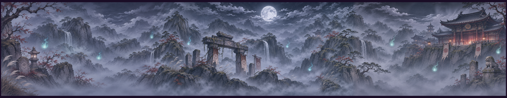

# 동양 판타지 2D 액션 RPG

Unity로 개발 중인 횡스크롤 액션 RPG입니다. 도사·수도승·여검사를 선택해 지역을 탐험하고, 퀘스트와 전투를 통해 캐릭터를 성장시킵니다. 현재 게임 진행과 저장은 로컬 플레이를 기준으로 구현되어 있습니다.

## 개발 환경

| 항목 | 버전 / 구성 |
|---|---|
| Unity Editor | **6000.3.23f1** |
| 렌더링 | Universal RP **17.3.0**, 2D Renderer |
| 카메라 | Cinemachine **3.1.7** |
| 입력 | Input System **1.20.0** |
| UI | Unity UI, TextMesh Pro, DOTween |
| 테스트 | Unity Test Framework **1.6.0**, 프로젝트 전용 Editor 검증 도구 |
| UI 기준 해상도 | 1920 × 1080 |

정확한 패키지 목록은 [manifest.json](Packages/manifest.json), 에디터 버전은 [ProjectVersion.txt](ProjectSettings/ProjectVersion.txt)를 확인합니다. DOTween은 `Assets/Plugins/Demigiant/`에 포함되어 있으며, Unity MCP는 Git URL 패키지로 등록되어 있습니다.

## 실행

1. Unity Hub에서 프로젝트 루트 폴더를 추가하고 **Unity 6000.3.23f1**로 엽니다.
2. 패키지 복원과 스크립트 컴파일이 끝날 때까지 기다립니다. Git URL 패키지 복원을 위해 Git과 네트워크 연결이 필요합니다.
3. [MainScreen.unity](Assets/_Project/Scenes/MainScreen.unity)를 열고 **Play → 게임 시작**을 누릅니다.
4. 캐릭터 선택 화면에서 도사·수도승·여검사 중 하나를 선택합니다.
5. Game 뷰를 클릭해 입력 포커스를 맞춥니다. 처음 생성한 캐릭터는 튜토리얼에서 시작하고, 기존 캐릭터는 저장한 진행 상태를 불러옵니다.

캐릭터 선택부터 확인하려면 [ChooseCharactor.unity](Assets/_Project/Scenes/ChooseCharactor.unity)를 엽니다. 파일명의 `Charactor` 표기는 현재 프로젝트에서 사용하는 실제 이름입니다.

기본 진입 흐름은 `MainScreen → ChooseCharactor → MovementPrototype`입니다. 튜토리얼 씬의 실제 경로는 `Assets/_Project/Scenes/TutorialMap/MovementPrototype.unity`입니다. 저장 기록이 있으면 복원 과정에서 저장된 지역으로 이동할 수 있습니다.

## 조작

| 동작 | 입력 |
|---|---|
| 좌우 이동 | ← / → |
| 점프 | Space |
| 통과 가능한 발판 아래로 내려가기 | ↓ + Space |
| 기본 공격 | Left Ctrl, 누르고 있으면 반복 공격 |
| NPC·오브젝트 상호작용 | T |
| 일반 포탈 이동 | 포탈 근처에서 ↑ |
| 대화 / 튜토리얼 진행 | Space |
| 스킬 단축키 8칸 | Q / W / E / R / A / S / D / F |
| 소모품 단축키 4칸 | 1 / 2 / 3 / 4 |
| 인벤토리 / 장비 / 능력치 / 스킬 | I / J / C / K |
| 지도 / 도감 / 동행요괴 | M / U / P |
| 던전 창 | O, 던전 기능 해금 후 |
| 혼석 창 | 활성화된 혼석 근처에서 G |
| 열린 UI 닫기 | Esc, 각 창의 닫기 동작 |

스킬은 K에서 습득한 뒤 단축창으로 드래그하고, 소모품은 인벤토리에서 소모품 단축창으로 드래그해 등록합니다. 일부 UI와 기능은 퀘스트·튜토리얼 진행에 따라 해금됩니다.

공중에서 좌우 이동은 가능하며 추가 점프는 불가능합니다. Space를 계속 누르고 있어도 착지 후 자동으로 다시 점프하지 않습니다. 도사의 텔레포트는 **↑를 누른 채 사용하면 위로 이동**하고, 발판이 있으면 착지하며 없으면 중력으로 떨어집니다.

입력 액션은 [InputSystem_Actions.inputactions](Assets/Settings/InputSystem_Actions.inputactions), 창·단축창 입력은 `Scripts/UI/`에서 관리합니다.

## 구현된 게임 시스템

### 캐릭터와 전투

| 직업 | 주요 전투 구성 | 플레이어 프리팹 |
|---|---|---|
| 도사 | 부적 투사체, 다중 부적 발사, 수평·상향 텔레포트, 피해 감소 보호막 | `Prefabs/Player/Player.prefab` |
| 수도승 | 근접 공격, 기력, 패링, 대시, 기력파 | `Prefabs/Player/MonkPlayer.prefab` |
| 여검사 | 검격, 대시, 연속 베기, 발도 공격 | `Prefabs/Player/SwordswomanPlayer.prefab` |

기본 공격 입력 버퍼, 공격 중 이동 제어, 피격·넉백·사망·부활, 스킬 자원 소모와 재사용 대기시간이 연결되어 있습니다. 레벨·경험치·직업 성장·스킬 포인트·전직은 각각 데이터 자산과 런타임 시스템으로 관리합니다.

### 퀘스트·탐험·성장

- **퀘스트와 대화:** 퀘스트 수락·거절·진행·완료 대화, 추적 UI, NPC 머리 위 상태 표시, 선행 퀘스트와 포탈 진행 조건을 지원합니다. 메인 퀘스트 외에 TempleGate 나그네의 인삼 줄기 수집 퀘스트가 있습니다.
- **아이템과 장비:** 인벤토리 슬롯 배치, 장비 착용, 등급·세트 효과, 소모품, 월드 드롭과 엽전, 상점 및 장비 강화를 지원합니다.
- **지역 탐험:** 씬 간 포탈, 도착 위치 복원, 로딩 화면, 미니맵·월드맵, 지역 발견, NPC·퀘스트 위치 표시와 몬스터 도감을 지원합니다.
- **동행요괴와 혼석:** 동행요괴의 획득·장착·추적·능력, 혼석 활성화와 이동 UI를 제공합니다.
- **던전:** 거인의 농장 입장, 여러 구역 이동, 제한시간, 보스 처치에 따른 클리어·귀환과 보상 처리를 지원합니다. 현재 던전 데이터는 `Data/Dungeons/GiantGarden.asset`에서 관리합니다.
- **맵 상태:** 일반 몬스터와 드롭의 임시 상태는 세션 내 지역 캐시로 관리하며, 보스 처치와 주요 진행 기록은 저장 시스템에 연결되어 있습니다.

### 몬스터와 최근 변경

공통 `EnemyController`가 탐지·순찰·추적·피격·보상·사망을 담당하고, `MON_*` 스크립트가 각 몬스터의 공격을 구현합니다. 공격 판정과 효과 발생은 각 몬스터의 구현에 맞춰 애니메이션 이벤트 등으로 연결됩니다.

- 도깨비불(`will-o'-the-wisp`): `isMoving`·`isAttacking`·`isDead` 상태 전환, 볼을 부풀린 뒤 발사하는 3발 곡선 공격, 서로 다른 도착점과 충돌·소멸 효과.
- Skull: 걷기 애니메이션에서 색이 튀던 프레임의 색감 보정.
- TempleGate: 씬 전환으로 진입한 경우에도 나그네의 퀘스트 상태 표시 갱신.
- TempleRoad: 세 배경의 연결부 복원, 청회색 밤 톤 통일, 가운데 달 하나만 유지.

## 씬 구성과 현재 제작 상태

| 구분 | 씬 / 폴더 | 상태 |
|---|---|---|
| 메뉴 | `MainScreen`, `ChooseCharactor` | 빌드 씬 목록에 등록 |
| 튜토리얼 지역 | `TutorialMap/MovementPrototype`, `PrologueVilage`, `Cemetery`, `SpiderCave`, `Marshland`, `BrokenSeal` | 빌드 씬 목록에 등록 |
| 지역 허브 | `GapInSpace` | 빌드 씬 목록에 등록 |
| 거인의 농장 | `GiantFarm/GiantFarm_01`, `GiantFarm_02`, `GiantFarm_03_Boss` | 빌드 씬 목록에 등록 |
| 옛 사찰 지역 | `OldTemple/SmogMountain`, `TempleGate` | 빌드 씬 목록에 등록 |
| 사찰로 향하는 길 | `OldTemple/TempleRoad` | 배경·발판 제작 중, 현재 빌드 씬 목록에는 미등록 |
| 새 맵 템플릿 | `Templates/Map_Template` | 제작용 템플릿 |

등록 상태의 기준은 [EditorBuildSettings.asset](ProjectSettings/EditorBuildSettings.asset)입니다. 새 씬을 포탈이나 던전에서 불러오려면 **Build Profiles → Scene List**에 추가하고 활성화해야 합니다. TempleRoad는 현재 배경 작업 상태이며, 완성된 플레이 구역으로 연결하려면 씬 등록과 입출구·플레이 구성 확인이 필요합니다.

새 맵의 생성·충돌 지형·포탈·카메라 경계 설정은 [맵 템플릿 안내](Assets/_Project/Scenes/Templates/README.md)를 참고합니다. 맵마다 Cinemachine 렌즈 크기와 Confiner 경계를 따로 설정하며, `CameraFollowDetail`과 `CameraBoundaryFinalizer`가 추적과 경계 처리를 보완합니다.

제작 중인 TempleRoad 배경 미리보기:



## 저장과 테스트 모드

- 저장 위치: `Application.persistentDataPath/Saves/class-{id}.json`
- 직업별 슬롯: 도사 `0`, 수도승 `1`, 여검사 `2`.
- 저장 항목: 지역·위치·체력·자원, 레벨·경험치·엽전, 인벤토리·장비·단축창, 스킬·전직, 퀘스트·보스 진행, 동행요괴, 지도·도감·튜토리얼 등.
- 자동 저장: 기본 10초 주기와 진행 상태 변경 후, 씬 이동 전후, 포커스 상실·일시 중지·종료 시점. 설정 UI에서 수동 저장도 가능합니다.
- 파일은 임시 파일을 거쳐 교체하고 이전 기록을 `.bak`으로 남깁니다. 기본 파일을 읽을 수 없으면 백업을 확인합니다.

에디터와 Development Build에는 개발용 조작이 있습니다.

| 입력 | 기능 |
|---|---|
| F10 | 관리자 패널: 위치 기록·복귀, 회복, 레벨 상승, 사망 테스트, 씬 이동, 시연용 초기화 |
| F9 | 고스트 모드 전환; 방향키로 비행, Shift로 가속 |

관리자 기능으로 상태를 변경하면 정상 진행을 한 번 저장한 후 테스트 세션으로 전환하고 이후 저장을 막습니다. 캐릭터를 다시 불러오면 정상 저장을 재개합니다. F10의 **초기화**는 이번 플레이의 시연 상태만 초기화하며, 다음 Play에서는 기존 저장 기록을 불러옵니다.

저장 참조 자산의 GUID 목록은 `Resources/SaveAssetCatalog.asset`에서 관리합니다. Play/빌드 전에 자동 갱신되며, **Eastern Fantasy → Save → Rebuild Asset Catalog**로 다시 만들 수 있습니다. 상세 저장·복원 검증 절차는 [저장 시스템 안내](Artifacts/SaveSystem/README.md)를 참고합니다.

## 프로젝트 구조

```text
Assets/_Project/
├─ Scenes/       메뉴, 튜토리얼, 던전, 사찰 지역, 맵 템플릿
├─ Scripts/      플레이어, 몬스터, 전투, 퀘스트, UI, 저장 등
├─ Data/         직업·성장·스킬·퀘스트·아이템·던전 데이터
├─ Prefabs/      Player, Enemy, UI와 재사용 오브젝트
├─ Resources/    런타임 로드 자산, 저장 카탈로그
├─ Editor/       씬·시스템 구성 도구와 기능별 검증 도구
├─ Art/          배경, 캐릭터, 몬스터, UI 이미지
├─ Animations/   애니메이션 클립과 Animator Controller
├─ Effect/       셰이더와 시각 효과
└─ Audio/        배경음과 효과음

Artifacts/       기능별 검증 결과, 작업 기록, 미리보기와 원본 백업
Captures/        게임·에디터 화면 캡처
```

주요 수정 지점:

| 작업 | 코드 / 자산 |
|---|---|
| 이동·점프·발판 | `Scripts/Player/PlayerMovement2D.cs`, `Data/Player/DefaultMovement.asset` |
| 입력·공격 버퍼 | `Scripts/Player/PlayerInputReader.cs`, `Scripts/Player/PlayerAttackInputBuffer.cs` |
| 직업 선택·프리팹 전환 | `Scripts/CharacterSelection/`, `Scripts/Player/PlayerClassRuntime.cs` |
| 스킬·직업별 공격 | `Scripts/Skill/`, `Data/Skills/` |
| 몬스터·스폰 | `Scripts/EnemyController.cs`, `Scripts/MON_*`, `Scripts/Spawning/` |
| 퀘스트 | `Scripts/Quest/`, `Data/Quest/` |
| 장비·상점·강화 | `Scripts/Inventory/`, `Scripts/Shop/`, `Scripts/UI/EquipmentUpgradeWindowUI.cs` |
| 던전 | `Scripts/Dungeon/`, `Data/Dungeons/` |
| 씬 전환·맵 상태 | `Scripts/PortalSceneTransition.cs`, `Scripts/SceneWorldState.cs`, `Scripts/PlayerLocationSetter.cs` |
| 저장·복원 | `Scripts/Player/SaveGameService.cs`, `Scripts/Player/SaveGameData.cs`, `Scripts/Player/SaveStateAdapters.cs` |

위 표와 직업 표의 경로는 `Assets/_Project/` 기준입니다.

## 검증과 작업 시 참고

`Assets/_Project/Editor/`에는 `*Setup.cs`와 `*Validation.cs` 도구가 있습니다. 각 검증은 실행 모드와 준비 상태가 다르므로 해당 파일의 진입 메서드를 확인합니다.

| 검증 도구 | 실행 기준 |
|---|---|
| `MapMainQuestValidation.Run()` | Edit Mode에서 지도 퀘스트 표시 검증 |
| `GinsengCollectionValidation.Run()` | Play Mode에서 수집·보상·퀘스트 표시 검증 |
| `WillOWispCombatValidation.Run()` | Play Mode에서 상태 전환·발사 시점·3발 곡선·충돌·공격 취소 검증 |
| `SaveSystemPlayValidation` | 격리된 저장 경로를 준비한 뒤 생성·재실행·복원 순서로 검증 |

저장 테스트는 Play 진입 전에 `SessionState`의 `EasternFantasy.SaveTestDirectory`를 별도 테스트 폴더로 지정해 수행합니다. 테스트가 끝나면 Play를 종료하고 해당 설정을 원래 값으로 복원합니다. `Setup` 도구 중에는 씬·프리팹·데이터를 저장하거나 다시 구성하는 도구가 있으므로 기능별 구현을 확인한 뒤 사용합니다.

최근 도깨비불 전투 검증은 [Artifacts/WillOWispCombat/Validation.txt](Artifacts/WillOWispCombat/Validation.txt), TempleRoad 톤·달·연결부 확인 기록은 [Artifacts/TempleRoadTone/Validation.txt](Artifacts/TempleRoadTone/Validation.txt)에 있습니다. 기록은 해당 작업 시점의 검증 결과이며, 프로젝트 전체 회귀 테스트 통과를 의미하지는 않습니다.

Git에서는 `.meta` 파일과 `Packages/`, `ProjectSettings/`를 소스 자산과 함께 관리합니다. `Library/`, `Temp/`, `Obj/`, 빌드 출력 등 Unity 생성 폴더는 `.gitignore`로 제외합니다.
